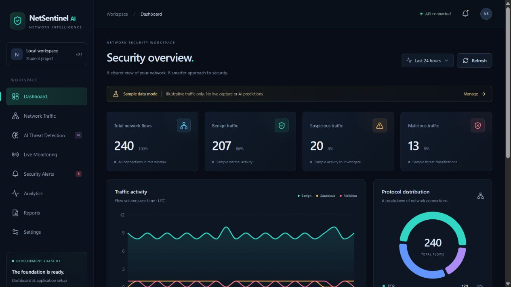
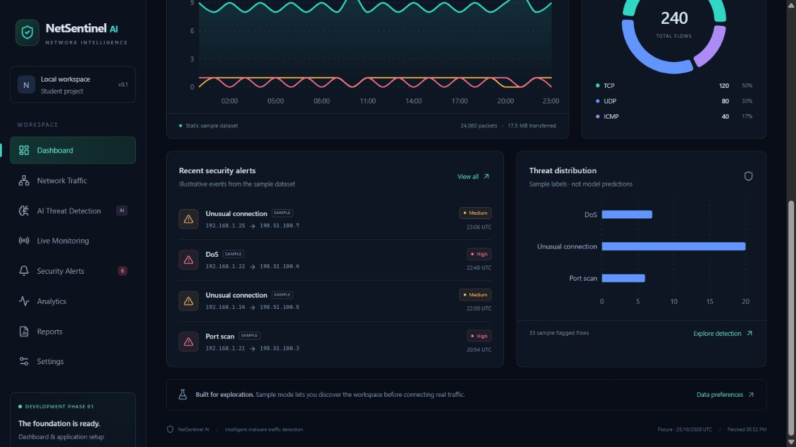

# Phase 1 delivery notes

These are historical notes from before the project was renamed FlowTwin. The Phase 1 screenshots preserve the earlier branding; current screenshots are in [Phases 2–4](phases-2-to-4.md).

## Implemented

The foundation includes eight navigable pages, the full dashboard, a sample flow browser, analytics, saved preferences, API connectivity feedback, loading/empty/error states, and responsive desktop/mobile navigation. The design uses deep navy surfaces, restrained cyan highlights, green benign labels, amber suspicious labels, and red malicious labels. Classification is also stated in text, so color is not the only signal.

Dialog dismissal supports Escape, the close button, and clicking the backdrop. Native modal behavior traps focus. Controls have accessible labels and visible keyboard focus; reduced-motion preferences disable CSS animations and reduce page movement. The phone layout collapses the sidebar into a menu and keeps the wide flow table horizontally scrollable.

## Created files

All project files are new; the initial workspace was empty.

- Root: `.gitignore`, `README.md`.
- Backend: `backend/__init__.py`, `backend/requirements.txt`, `backend/app/__init__.py`, `database.py`, `models.py`, `schemas.py`, `demo.py`, `main.py`, and `backend/tests/test_api.py`.
- Frontend: `frontend/package.json`, `package-lock.json`, `vite.config.js`, `index.html`, `public/favicon.svg`, `src/main.jsx`, `App.jsx`, `components.jsx`, `charts.jsx`, `pages.jsx`, `api.js`, `styles.css`, `test-setup.js`, `pages.test.jsx`, and `api.test.js`.
- Future-module boundaries: `ml/README.md`, `datasets/README.md`.
- Documentation: `docs/architecture.md`, `docs/phase-1.md`, `docs/screenshots/phase-1-dashboard.png`, `docs/screenshots/phase-1-dashboard-details.png`.
- Local generated/ignored files: `.venv/`, `frontend/node_modules/`, `frontend/dist/`, `backend/flowtwin.db`, and test caches. These should not be committed.

## Automated checks

Verified on 25 October 2026 on Windows, Python 3.13.14 and Node.js 24.13.1:

| Check | Result |
| --- | --- |
| Backend pytest suite | 14 passed |
| Frontend Vitest suite | 6 passed |
| Production build, Vite 8.3.5 | Passed |
| npm dependency audit after updating Vite | 0 known vulnerabilities |
| Frontend HTTP on port 5174 | 200 |
| API health through the frontend proxy | `ok`, SQLite connected |
| Desktop browser smoke checks | All eight pages loaded |
| Mode isolation and outage recovery in browser | Passed |

The backend test runner emits one upstream Starlette/AnyIO deprecation warning. The production build emits a non-failing bundle-size warning (about 778 kB JS, 233 kB gzip); lazy chart loading is a future optimization. Neither is a startup or test failure. Frontend tests use a single worker thread to reduce Windows process startup overhead. An earlier rerun timed out during worker startup; after separating chart imports from form components, the final six-test run passed without unhandled errors in 54.86 seconds.

Both local servers started successfully and were stopped after verification. Restart them with the root README commands before opening the dashboard.

Run the commands in the root README. Backend tests use a separate in-memory SQLite database and override API session dependencies, so tests do not modify the workspace database.

The API suite covers health/readiness, consistency across aggregate totals and chart series, 1/6/24-hour windows, search/filtering/pagination, detail reads, settings persistence, invalid-input rejection, idempotent seeding, and fixture isolation when sample mode is disabled.

Frontend component tests cover save-before-persist behavior, API failure feedback, search/protocol/classification query construction, empty results, and failure without a local fixture fallback. HTTP-client tests cover unsuccessful status codes and preserved JSON settings writes.

## Manual acceptance walkthrough

### Browser verification and screenshots

Desktop browser checks exercised all eight destinations, overview time filtering, combined TCP/malicious flow filtering, sample flow inspection, Escape dismissal, settings saves, mode off/on, save feedback, and API outage/retry recovery. The preview uses **port 5174** because another application already owns 5173.

No unexpected browser console errors were observed during normal operation. Deliberately stopping the backend produced the expected visible error, and Retry recovered after restart. Sample mode and the 30-second refresh preference were restored for demonstrations.

A dedicated mobile viewport was not available in the browser tool. Phone breakpoints are implemented but not visually verified here. Desktop visual inspection used a 1265 × 714 viewport.

### Repeatable acceptance steps

1. Start backend and frontend. Confirm health reports `status=ok`, `database=connected`, `phase=1`, `model=not_trained`.
2. Open Dashboard. Verify the sample banner and 240 total flows: 207 benign, 20 suspicious, 13 malicious. Confirm charts are visible.
3. Choose Last hour, then Last 6 hours: totals should be 10 and 60 respectively. Return to Last 24 hours.
4. Open Network Traffic. Search an IP, choose TCP and malicious, clear filters, move to the next page, and inspect a row. Close with Escape.
5. Visit all eight destinations. Confirm later-phase capability notices and disabled report buttons. There must be no apparent running capture, model score, or exported report.
6. In Settings, turn Sample data mode off and save. Return to Dashboard: zero totals and empty charts. Network Traffic must contain no sample records. Return to Settings and restore sample mode.
7. Change the refresh interval and save. Reload the browser (or restart the backend) and confirm the value remains. Restore 30 seconds for demonstrations.
8. Stop the backend and click Refresh. Confirm the connection error replaces dashboard data and Retry connection is available. Restart the backend and retry.
9. Check narrow/mobile layout, sidebar toggle, chart containment, table horizontal scroll, keyboard focus, and reduced motion.
10. Open Project guide and follow the local API documentation link.

## Limitations / next phase

PCAP uploads, Scapy parsing, flow extraction, live capture/replay, Random Forest training/inference, WebSockets, alert lifecycle updates, CSV/PDF exports, and measured model performance are deliberately unimplemented. AI Detection and Reports contain honest interface scaffolding. Alert rows are projections of flagged sample flows, not independent alert records.

The sample time window is fixed and relative to the latest fixture, and the flow table shows its complete 24-hour sample. UI search is server-backed but the backend filters the small fixture in memory. This local single-user application is not ready for public deployment. These boundaries are explicit in both the UI and API.

Phase 1 originally stopped here. The user subsequently requested all remaining phases together; the current integrated build is documented in [Phases 2–4](phases-2-to-4.md).
